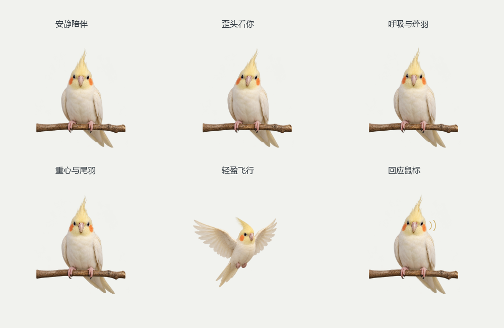
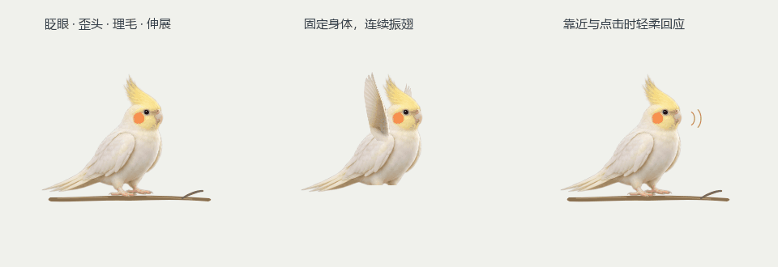
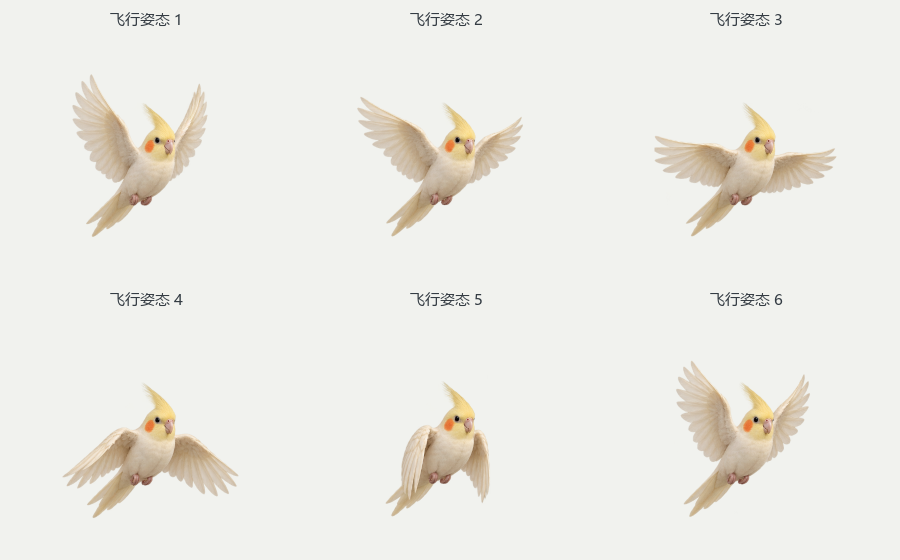

# Cockatiel Desktop Pet

A silent, original feathered cockatiel that rests on a branch and flies around the
**primary Windows display**, either behind desktop icons or in front of applications.
Choose the mode from the system tray, or hide the pet. No accounts,
network requests, telemetry, audio, autostart, keyboard hooks, or input injection.



## 1.2 朝向、抓握与动作修正版

新版采用偏正面的原创奶白色玄凤，双眼与两侧腮红可见。爪子和树枝在同一张
素材中完成抓握，待机变形固定脚踝以下的接触区。呼吸、重心轻移、颈部侧倾、
冠羽和尾羽采用不同节奏，配合短促眨眼与偶发蓬羽动作。
飞行改用六个完整鸟体姿态，包括双翼肩部连接、收脚和尾羽，移除了旧的
站立身体加旋转翅膀。飞行使用每秒四次的六帧循环，不叠加半透明双翼。
起飞释放脚部时切换为空中姿态，落地接触时恢复抓枝姿态。
暂停时只绘制静态画面。
桌面后方 / 所有应用前方 / 隐藏三种显示模式均保留。



这是运行时渲染器直接导出的动画。素材随程序离线打包，运行时不调用 AI，
不下载模型、不连接网易云音乐。素材制作提示词见
[ARTWORK.md](src/cockatiel_pet/assets/ARTWORK.md)。



参考观察的限制：当前窗口工具只能捕获网易云主窗口中的宠物预览，无法直接
捕获独立桌宠窗口。本版没有宣称已观测或复现其桌面动画，仍为本地 2D 动画。

## Run the supplied executable

The GitHub repository contains source code; generated executables are excluded.
Build the Windows bundle with `scripts/build_windows.ps1` using the source setup
instructions below, or use a packaged runtime folder supplied separately.

Open `dist/CockatielDesktopPet/CockatielDesktopPet.exe`. Keep the entire folder,
including `_internal/`, together. The application has no normal main window;
look for the cockatiel in the Windows notification area (including hidden icons).
Use its tray menu to quit. No administrator permission is needed.

The default desktop mode requires a verified Explorer host. If that host cannot
be verified, the pet remains hidden and retries every three seconds. Front mode
is only used when explicitly selected; it is never an automatic fallback. The
supplied build is unsigned.

## 显示模式（按用户后续要求新增）

右击托盘里的鸟图标 → **显示模式**，可以选择：

- **桌面后方**：位于桌面图标和普通应用后面。
- **所有应用前方**：置顶显示，仍保持透明、鼠标穿透、不抢键盘焦点。
- **隐藏**：销毁显示窗口、停止绘制，保留托盘以便再次显示。

选择会保存，重启后恢复。置前模式下也可以响应鼠标靠近和点击，实际点击仍
传给下方应用。此项后续需求覆盖原始规格中的“只能在桌面”和“禁止置顶”约束；
原始规格文件作为历史输入保留，桌面模式仍执行原来的严格宿主校验。

## Install and run from source

Windows 10/11 **x64**, a normal Explorer desktop, and Python **3.12+** are required.
The supplied build was exercised with Python 3.13.12 / Qt 6.8.3 on Windows build
26200. Other Windows builds still require the manual acceptance checks below.
macOS, Linux, ARM64 builds, and non-Explorer shells are unsupported.

Run in PowerShell from this project directory:

```powershell
py -3.12 -m venv .venv
.\.venv\Scripts\Activate.ps1
python -m pip install -e ".[dev]"
python -m cockatiel_pet
python -m pytest -q
.\scripts\build_windows.ps1
```

`py -3.13` is also supported. If activation is restricted, call
`.\.venv\Scripts\python.exe` directly. Installation/build downloads dependencies;
the installed application itself does not use the network. The dependency is
`PySide6-Essentials`, which provides PySide6's QtCore/QtGui/QtWidgets without the
unused browser, PDF, and multimedia modules. Qt 6.8.x is pinned for this build.

## Controls

Right-click the cockatiel tray icon:

| Action | Behavior |
| --- | --- |
| 显示模式 | 桌面后方 / 所有应用前方 / 隐藏. Mode changes destroy the old window before creating the new one. |
| 暂停 / 继续 | Settles at the current safe foot position and draws one static branch pose. Resume starts a fresh rest period. |
| 立即飞行 | Starts a trip from a resting perch; disabled while paused, hidden, or already flying. |
| 鼠标互动：开 / 关 | Enables passive head tracking, hover blinks and silent visual chirps. Desktop mode gates reactions on Explorer exposure; front mode also reacts over apps. |
| 退出 | Stops timers, destroys the drawing window, saves settings, and releases the single-instance mutex. |

Clicks always pass through the drawing surface. The pet is not draggable. A
second launch exits without creating another pet. Hover reactions require 300 ms
on the bird; hover and click responses have separate rate limits. An uncertain
desktop hit is ignored. A button held while moving from another application
cannot produce a new click reaction.

## Configuration and diagnostics

Settings: `%APPDATA%\CockatielDesktopPet\config.json`.
Edit while the pet is closed, then relaunch. Missing, malformed, too large, or
unknown-schema files load safe defaults. Writes are atomic and best effort.

```json
{
  "schema_version": 1,
  "pet_scale": 1.0,
  "mouse_interaction_enabled": true,
  "paused": false,
  "display_mode": "desktop",
  "idle_min_seconds": 20,
  "idle_max_seconds": 55,
  "active_fps": 30,
  "idle_fps": 12,
  "audio_enabled": false,
  "show_on_primary_monitor_only": true
}
```

Scale is clamped to 0.5–2; rest times to 10–600 seconds; active FPS to 15–60;
idle FPS to 5–15. Maximum rest cannot be smaller than minimum rest. Audio remains
disabled and primary-monitor-only remains enabled in this MVP. Tiny usable
displays shrink the artwork further so its entire viewport remains reachable.

```powershell
python -m cockatiel_pet --diagnose
python -m cockatiel_pet --debug-desktop-host --seed 42
python -m cockatiel_pet --force-hidden --run-seconds 5
python -m cockatiel_pet --run-seconds 45 --diagnostic-report work\lifecycle.json
```

Create `work/` first if using that diagnostic-report path. Logs are bounded,
rotating files at `%APPDATA%\CockatielDesktopPet\desktop.log`. Debug logs contain
window handles, classes, shell topology and state transitions, **never pointer
samples or click history**. `--config PATH` isolates a diagnostic configuration.
Reports contain timing, frame counts, states, display modes, DPI and native safety status.
`display_mode` accepts `desktop`, `front`, or `hidden`; older configs default to
`desktop`. Invalid values also use `desktop`.

## Architecture and implementation milestones

The work was implemented in specification order:

1. **A: Native hosting.** `desktop_host.py` verifies Explorer ownership, desktop
   icon ancestry, wallpaper geometry, visibility, and front-to-back ordering.
   Classic top-level WorkerW and newer Progman-child WorkerW layouts are handled.
   Creation requests use bounded `SendMessageTimeoutW` calls, including newer
   raised-desktop parameter variants. Ambiguous layouts are rejected.
2. **B: Artwork.** Version 1.2 uses original near-frontal feathered sprites and
   six complete flight cels cached in premultiplied-alpha images. Registered eye
   patches blink. Continuous body deformation keeps the branch/gripping-foot
   band fixed while the chest, neck, crest and tail move at independent rhythms.
   The seeded gesture director leaves quiet gaps between larger movements.
3. **C: Flight.** Pure Python seeded state/geometry modules implement resting,
   takeoff, eased cubic Bézier flights, landing, reactions, and pause. Perched
   artwork stays planted until release; complete airborne anatomy is selected
   until landing contact. Normal elapsed time is substepped;
   sleep gaps are capped. Resizing re-clamps to a reachable primary-display perch.
4. **D: Input observation.** `mouse_observer.py` classifies 20 Hz passive samples.
   Win32's actual hit target must belong to a verified Explorer desktop ancestry.
   Application, taskbar, Start, menu and unknown hit targets are ignored in
   desktop mode. Explicit front mode observes the pointer over applications too.
5. **E: Lifecycle.** Tray, atomic JSON configuration, per-session named mutex,
   three-second structural checks, display change callbacks, safe reattachment,
   diagnostics, tests and Windows packaging.

`pet_surface.py` uses the specification's **native layered-child rendering
alternative**. Qt paints a small premultiplied-alpha QImage; a cached native DIB
and `UpdateLayeredWindow` present it in a window **created as a hidden WS_CHILD
of the verified host from the start**. This avoids Qt HWND recreation and
cross-process `SetParent` DPI resets. There is no top-level pet HWND to fall back
to, and no Explorer window style or window procedure is changed.

Required extended styles are layered, transparent, tool-window and no-activate.
Desktop mode rejects topmost and app-window styles. Front mode uses a separate
small native topmost popup, without parenting it to Explorer, and still rejects
app-window/focus/input-capturing behavior. `HTTRANSPARENT` is an
additional defense; the layered/transparent styles provide native pass-through.
Native pointers have explicit 64-bit ctypes signatures. Layout and pointer
coordinates are physical pixels; ScreenToClient maps moves to host-client
coordinates. Per-monitor-v2 awareness is requested before Qt and in the build
manifest. No QWidget is used for the pet, and no Qt WinIdChange can promote it.

In desktop mode the host and native parent/styles are checked before each rendered frame; full
topology is checked every three seconds even while paused. When invalid, the
surface is hidden/destroyed before rediscovery. The native child is also
automatically destroyed by Windows if its Explorer parent is destroyed.

Microsoft references: [window relationships and layered transparency](https://learn.microsoft.com/en-us/windows/win32/winmsg/window-features),
[UpdateLayeredWindow](https://learn.microsoft.com/en-us/windows/win32/api/winuser/nf-winuser-updatelayeredwindow),
[SetParent and DPI caveats](https://learn.microsoft.com/en-us/windows/win32/api/winuser/nf-winuser-setparent),
[bounded shell messaging](https://learn.microsoft.com/en-us/windows/win32/api/winuser/nf-winuser-sendmessagetimeoutw).
WorkerW shell messaging/topology is undocumented and varies across releases.

## Verification and packaging

```powershell
python -m pytest -q
python scripts\desktop_probe.py --seconds 8
python scripts\smoke_windows.py --output work\native-smoke.json
.\scripts\build_windows.ps1 -Python .\.venv\Scripts\python.exe
python scripts\verify_bundle.py --output work\bundle-smoke.json
python scripts\probe_front_hit.py --output work\front-hit.json
python scripts\render_motion_preview.py --output docs\motion-preview.gif
python scripts\package_release.py
```

Close any running pet before the native smoke test. The first probe presents a
small opaque marker for two seconds, then a transparent one, and exits. Both
use the same fail-closed child implementation. The lifecycle smoke exercises
native flight, pause/resume, interaction toggles, simulated host loss, safe
reattachment and quit. Neither script injects input or restarts Explorer.

The build script runs tests, generates the original icon, invokes PyInstaller
`--onedir --windowed`, embeds a DPI-aware/asInvoker manifest, and includes notices
and license texts. Output: `dist/CockatielDesktopPet/CockatielDesktopPet.exe`.
`-DistPath` and `-WorkPath` can override build destinations. Keep `_internal/`
with the executable. See `THIRD_PARTY_NOTICES.md` and the bundle's `licenses/`.

See `docs/VALIDATION.md` for executed checks and their limits. Automated tests do
not send input, modify Explorer, require elevation, or require Explorer on CI.
Unit tests cover geometry/DPI conversion, seeded paths and timing, transitions,
pause, reactions/cooldowns, configuration, artwork loading, animation cadence,
alpha compositing, rendering, and fail-closed host logic. Pillow is used only
by the developer's GIF preview exporter, not by the running pet.

## Known limitations

- Native visual composition and real click-through still require manual checks
  on each target Windows build. Successful native API calls and structural checks
  alone do not prove the visible compositor result. The manual checklist below
  remains **not yet verified** unless explicitly recorded in `docs/VALIDATION.md`.
- A real Explorer restart, user-driven DPI/resolution changes and fullscreen
  application behavior have not been manually exercised in this session.
- Front mode intentionally appears above ordinary applications. Exclusive
  fullscreen games, secure desktops/UAC and system surfaces may cover it. It
  never elevates or tries to bypass those surfaces.
- Primary-monitor roaming only. Other monitors are ignored; mixed-DPI geometry
  has automated coverage, not a complete physical-display acceptance run.
- Shell alternatives, hidden desktop icons, shell customization software and
  future Windows changes may prevent host validation. Desktop mode remains hidden
  in that case; front mode can be explicitly selected from the tray.
- No sound, startle/hop, settings dialog, installer, automatic updates or autostart.
  In desktop mode a fullscreen application covers the bird; animation is not suspended
  solely because another application is fullscreen.
- CPU/memory figures in diagnostics are measurements of this host, not guarantees.
  One-core CPU percentage differs from Task Manager's whole-machine percentage.

## Windows manual acceptance checklist

The original checklist below applies to **desktop mode**. All unchecked items
are **not yet verified manually**. Run with
`--debug-desktop-host`, expose the desktop, and keep the tray accessible. Use
立即飞行 to inspect a full trip, then 暂停 to test a fixed click-through location.
For Explorer recovery, save your work before choosing Windows Explorer → Restart
in Task Manager; the application itself never restarts it. For DPI tests use
Windows Settings → System → Display at 100%, 125%, 150%, then change resolution
and primary monitor. Test hidden mode separately with `--force-hidden`.

- [ ] The bird is visibly a cockatiel and has a transparent background.
- [ ] It starts perched on a short branch with feet aligned to the branch.
- [ ] It flies between at least two perches using a continuous animated trajectory.
- [ ] The branch is absent during mid-flight and reappears for landing/resting.
- [ ] Hovering near the bird on the desktop produces a subtle reaction.
- [ ] Clicking through the bird does not prevent selecting or opening a desktop icon.
- [ ] Drag-selecting desktop icons and right-clicking the desktop still work normally.
- [ ] Open Notepad/browser and position it over the bird: bird is entirely **behind** the application window, never drawn on top.
- [ ] Typing, scrolling, and dragging in other apps remain unaffected.
- [ ] Bird is absent from Alt+Tab and does not steal focus or show a regular taskbar button.
- [ ] Fullscreen apps, Start menu, and taskbar are unobstructed.
- [ ] Pause/Resume, Fly Now, and Quit work from the tray.
- [ ] Explorer restart causes graceful hide/re-attachment, without duplicate birds.
- [ ] Reboot/relaunch and screen resolution/DPI changes do not corrupt placement.
- [ ] Windows 10/11 compatibility claims are limited to versions actually tested.
- [ ] If desktop attachment fails, the visual pet stays hidden: **no unsafe floating-window fallback**.

Additional acceptance checks for the later display-mode requirement (not yet
verified manually):

- [ ] 右击托盘 → 显示模式，可以切换桌面后方 / 所有应用前方 / 隐藏。
- [ ] 所有应用前方模式可盖在普通应用上，但点击、打字和滚动仍传到下方应用。
- [ ] 隐藏模式不显示宠物，仍能通过托盘重新显示。
- [ ] 切换模式不会出现重复宠物、抢焦点或普通任务栏按钮；重启后恢复选择。
